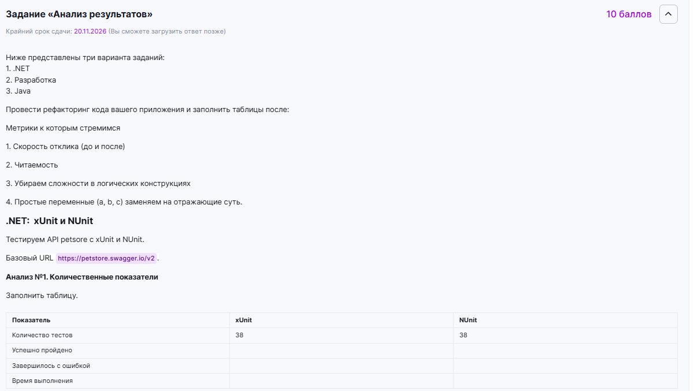
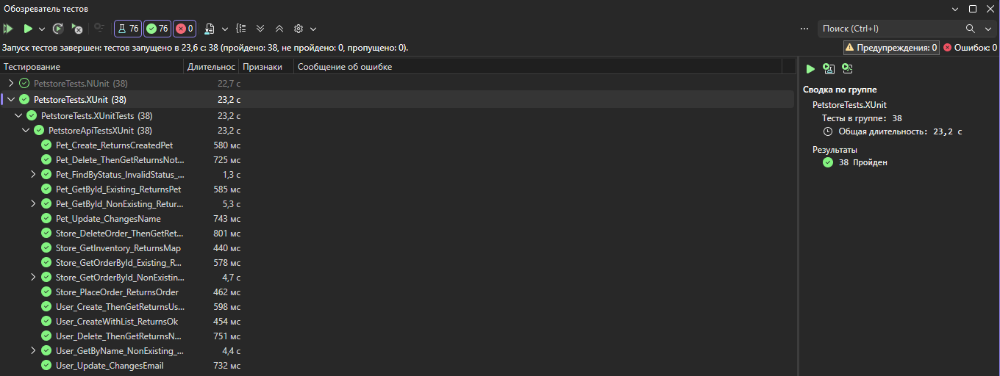
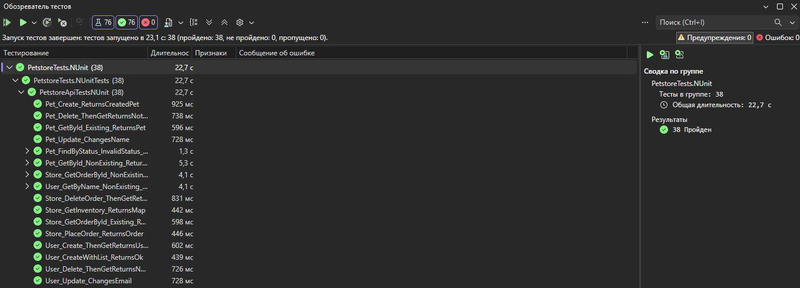

# Petstore API: тесты на xUnit и NUnit

Нужно было протестировать публичное API Petstore (https://petstore.swagger.io/v2) двумя
фреймворками .NET — xUnit и NUnit - и сравнить их между собой.

## Что сделано

В репозитории два проекта с одинаковым набором тестов:

PetstoreTests.XUnit - 38 тестов
PetstoreTests.NUnit - 38 тестов

Тесты проверяют три сущности: pet, store и user. В каждой есть обычные операции
(создать, получить, изменить, удалить) и негативные проверки — например, запрос
несуществующего id должен вернуть 404. Часть тестов параметризованная: метод один,
а наборов данных много. В xUnit это [Theory] и [InlineData], в NUnit — [TestCase].

Оба набора проходят полностью: 38 из 38.

Пока писал тесты, столкнулся с несколькими проблемами и решил их так:

1. Данные генерируются случайно (id, username). Petstore — общий демо-сервер, и с
   фиксированными id тесты мешают друг другу.
2. Публичный сервер иногда отвечает 500 или подвисает, поэтому все запросы идут через
   небольшой класс Api с четырьмя попытками.
3. После записи сервер не сразу отдаёт новые данные — изменения проверяются с задержкой
   (метод Api.Eventually).
4. В негативных тестах перед проверкой 404 запись удаляется. Иначе на общем сервере может
   оказаться питомец с таким же id, созданный кем-то другим.

## Другие файлы

analysis.md - таблицы анализа и сравнение фреймворков
questions.md - ответы на контрольные вопросы

## Скриншоты

Задание:

Результат xUnit:

Результат NUnit:

